# Дизайн-система SystemKeeper

Дизайн-система веб-интерфейса SystemKeeper. Взята из DevPilot (`../DevPilot/resources`): та же палитра Mint/Ink, шрифты, компоненты shadcn-vue и раскладка страниц. Оба продукта выглядят как одно семейство, отличаются только знаком и названием.

## Что лежит в каталоге

| Файл | Что это |
| --- | --- |
| `README.md` | Это описание: принципы, токены, компоненты, паттерны, сопоставление статусов SystemKeeper |
| `tokens.css` | Готовый `resources/css/app.css` для Tailwind v4: палитра, светлая и тёмная темы, базовые стили |
| `tokens.json` | Те же токены в машиночитаемом виде (для мобильного клиента, Figma, писем) |
| `showcase.html` | Живая витрина: все компоненты и экраны-образцы в светлой и тёмной теме. Открывается локально, без сборки и CDN |
| `logo.svg` | Знак SystemKeeper (предложение): щит и галочка |
| `fonts/` | Manrope Variable и JetBrains Mono 400/500 (латиница и кириллица, лицензия OFL), подключены в витрине |
| `screenshots/` | Снимки витрины: `light-*.png`, `dark-*.png` |

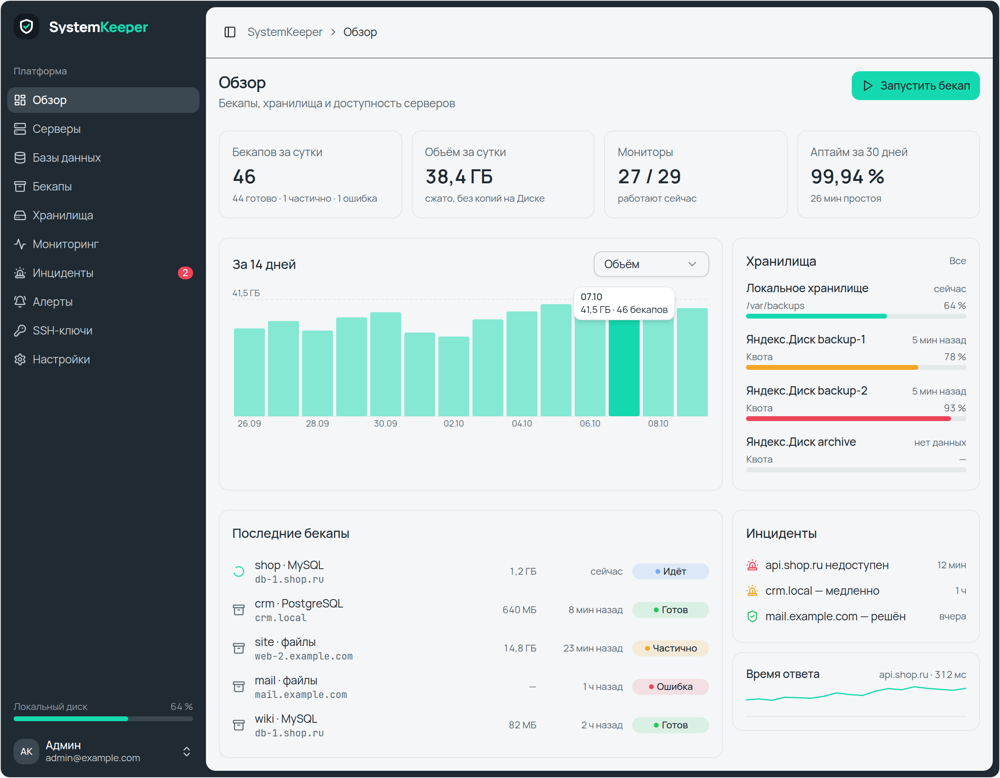
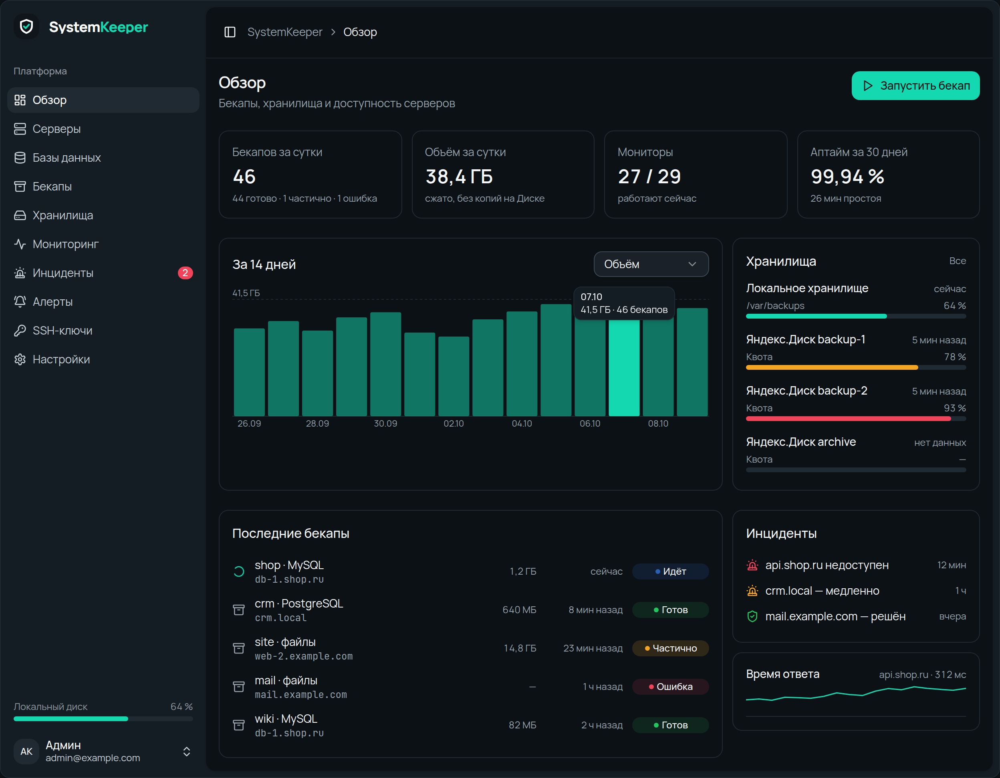

---

## 1. Принципы

1. **Тихий интерфейс, яркий акцент.** Почти всё серо-графитовое (Ink), Mint только там, где нужно действие или фокус: основная кнопка, активный пункт меню, кольцо фокуса, первая серия графика.
2. **Статус — точка и мягкая заливка.** Не красим текст и карточки целиком: состояние передают цветная точка и фон с прозрачностью 12–15 % (`StatusBadge`). Текст при этом остаётся `foreground`.
3. **Плотность ради обзора.** Основной текст `text-sm`, мета `text-xs`, отступы страницы `p-4`. На одном экране оператор должен видеть все серверы и бекапы.
4. **Моноширинный для машинного.** Хосты, пути, имена ключей, отпечатки, размеры в байтах, cron-выражения пишем `font-mono`. Числа в таблицах и плитках — `tabular-nums`.
5. **Две темы на равных.** Каждая страница проверяется в светлой и тёмной теме. Цвета берём только из семантических токенов (`bg-card`, `text-muted-foreground`), не из `ink-*`/`mint-*` напрямую. Исключения: логотип и сайдбар.
6. **Русский интерфейс.** Короткие подписи-глаголы («Добавить сервер», «Проверить»), даты в `ru-RU` (`dd.MM, HH:mm`), пустые значения — тире `—`.

## 2. Стек

- Tailwind CSS v4 с токенами через `@theme inline`, плагин `tw-animate-css`.
- shadcn-vue, стиль `new-york-v4`, примитивы reka-ui, утилиты `class-variance-authority`, `clsx` и `tailwind-merge` (`cn()`).
- Иконки — Lucide (`@lucide/vue`), по умолчанию `size-4`.
- Тосты — `vue-sonner`, графики — свои лёгкие SVG-компоненты без библиотек.
- В DevPilot всё это работает на Inertia + Vue 3. Если SystemKeeper пойдёт по тому же пути, компоненты из `../DevPilot/resources/js/components/ui` можно копировать как есть. На Blade хватит тех же классов Tailwind из рецептов ниже.

## 3. Цвет

### 3.1 Палитра

| Шаг | Mint (акцент) | Ink (нейтральные) |
| --- | --- | --- |
| 50 | `#e8fbf6` | `#f4f6f7` — фон светлой темы (Cloud) |
| 100 | `#c4f5e8` | `#e3e8eb` — рамки, muted |
| 200 | `#8aebd3` | `#c5ced4` — рамки полей, текст сайдбара |
| 300 | `#4fe2bf` | `#94a1ab` — вторичный текст в тёмной теме |
| 400 | **`#14d9b0`** — primary, ring, chart-1 | `#5b6873` — вторичный текст в светлой теме |
| 500 | `#0fb894` | `#3b4852` — рамки в тёмной теме, hover в сайдбаре |
| 600 | `#0a8f72` — ссылки на светлом | **`#1f2a33`** — основной текст, сайдбар (Cockpit Ink) |
| 700 | `#086b56` — текст на accent | `#151d24` — карточки в тёмной теме |
| 800 | `#06473a` — accent в тёмной теме | `#0c1116` — фон тёмной темы |

Системные цвета: success `#22c55e`, warning `#f5a524`, info `#3b82f6`, destructive `#ef4459`. Для **текста** на светлом фоне есть затемнённые варианты `success-text` `#15803d` и `warning-text` `#a15c00`.

### 3.2 Семантические токены

| Токен | Светлая | Тёмная | Где используется |
| --- | --- | --- | --- |
| `background` | `#f4f6f7` | `#0c1116` | фон страницы |
| `foreground` | `#1f2a33` | `#f4f6f7` | основной текст |
| `card` / `popover` | `#ffffff` | `#151d24` | карточки, меню, диалоги |
| `primary` | `#14d9b0` | `#14d9b0` | основные кнопки, чекбоксы, активные элементы |
| `primary-foreground` | `#1f2a33` | `#0c1116` | текст на mint (всегда тёмный, не белый!) |
| `secondary` / `muted` | `#e3e8eb` | `#1f2a33` | вторичные кнопки, подложки, трек прогресса |
| `muted-foreground` | `#5b6873` | `#94a1ab` | подписи, мета, плейсхолдеры |
| `accent` | `#e8fbf6` | `#06473a` | hover у ghost/outline кнопок и пунктов меню |
| `accent-foreground` | `#086b56` | `#8aebd3` | текст на accent |
| `destructive` | `#ef4459` | `#ef4459` | удаление, ошибки, «упал» |
| `link` | `#0a8f72` | `#14d9b0` | текстовые ссылки |
| `border` | `#e3e8eb` | `#1f2a33` | рамки карточек, разделители |
| `input` | `#c5ced4` | `#3b4852` | рамки полей ввода |
| `ring` | `#14d9b0` | `#14d9b0` | кольцо фокуса (`ring-ring/50`, 3px) |
| `chart-1…5` | mint · ink · info · warning · destructive | mint · ink-300 · info · warning · destructive | серии графиков |
| `sidebar` | `#1f2a33` | `#151d24` | боковая панель тёмная в обеих темах |

### 3.3 Правила

- Белый текст на Mint не используем: контраст недостаточный. На `bg-primary` всегда `text-primary-foreground`.
- Mint-текст на светлом фоне — только `text-link` (Mint 600), не `text-primary`.
- Прозрачности: заливка статусов `/12`, warning `/15`, hover основной кнопки `/90`, подложка кода `bg-muted/40–60`, оверлей диалога `bg-black/80`.
- В DevPilot местами остались прямые `emerald-500` / `red-500` / `amber-500` (индикаторы SSH, VPN). В SystemKeeper вместо них используем `success` / `destructive` / `warning`.

## 4. Типографика

- **Manrope Variable** — весь интерфейс. **JetBrains Mono** 400/500 — код, хосты, пути, идентификаторы.
- `antialiased` на `body`.

| Роль | Классы |
| --- | --- |
| Заголовок страницы (`Heading`) | `text-xl font-semibold tracking-tight` + описание `text-sm text-muted-foreground`, блок `mb-8 space-y-0.5` |
| Малый заголовок (`Heading variant="small"`) | `text-base font-medium mb-0.5` |
| Заголовок карточки/секции | `font-medium` (h3 в карточке), `leading-none font-semibold` в `CardTitle` |
| Заголовок диалога | `text-lg leading-none font-semibold` |
| Заголовок на экране входа | `text-xl font-bold tracking-tight` |
| Основной текст | `text-sm` |
| Мета, подсказки, бейджи | `text-xs text-muted-foreground` |
| Заголовки таблиц | `text-xs text-muted-foreground font-normal text-left` |
| Подписи осей | `text-[11px] text-muted-foreground` |
| KPI-число | `text-2xl font-semibold tabular-nums` |
| Логотип-надпись | `text-lg font-extrabold tracking-tight leading-none` |
| Markdown | `.markdown`: `text-[15px] leading-relaxed`, код `text-[13px]` |

Частота размеров в DevPilot: `text-xs` (306 раз) > `text-sm` (251) ≫ остальные. Интерфейс держится на этих двух размерах.

## 5. Форма, отступы, тени

- **Радиус:** базовый `--radius: 0.75rem`. `rounded-md` (10px) — кнопки, поля, меню, строки списков. `rounded-lg` (12px) — алерты, диалоги, сегментированные переключатели. `rounded-xl` (16px) — карточки и панели страниц. `rounded-2xl` — плитка логотипа на экране входа. `rounded-full` — бейджи, точки статуса, прогресс-бары.
- **Отступы:** страница `flex flex-col gap-6 p-4`. Сетки карточек `gap-3` (дашборд) или `gap-4` (списки сущностей). Внутри карточки `p-4`, у shadcn `Card` `py-6 px-6 gap-6`. Формы: поле `grid gap-2`, между полями `space-y-4`.
- **Тени** почти не используются: `shadow-xs` у полей и outline-кнопок, `shadow-sm` у `Card`, `shadow-md` у поповеров и тултипов графиков, `shadow-lg` у диалогов и шторок. Глубину задаём рамкой `border`, а не тенью.
- **Скроллбары** тонкие: `scrollbar-width: thin`, цвет `ink-200` / `ink-500` в тёмной теме.

## 6. Раскладка

### 6.1 Оболочка приложения (`AppSidebarLayout`)

```
┌──────────────┬──────────────────────────────────────────────┐
│ ▣ Logo       │ [≡] Хлебные крошки                    h-16    │  ← border-b border-sidebar-border/70
│              ├──────────────────────────────────────────────┤
│ Навигация    │  Heading + кнопка действия справа            │
│  • пункт     │                                              │
│  • пункт     │  контент: flex flex-col gap-6 p-4            │
│ ...          │                                              │
│ ─ Нагрузка   │                                              │
│ ─ Пользователь│                                             │
└──────────────┴──────────────────────────────────────────────┘
  16rem, Ink         SidebarInset (variant="inset")
```

- `Sidebar collapsible="icon" variant="inset"`: ширина 16rem, свёрнутый 3rem (только иконки), на мобильных выезжает шторкой шириной 18rem. Горячая клавиша Ctrl/Cmd+B.
- Сайдбар тёмный в обеих темах. Пункт меню: `rounded-md px-2 h-8 text-sm`, hover/active `bg-sidebar-accent text-white`. В шапке логотип (`SidebarMenuButton size="lg"`), в подвале служебные виджеты и меню пользователя.
- Шапка контента: `h-16` (при свёрнутом сайдбаре `h-12`), `SidebarTrigger` и `Breadcrumbs`.
- Глобально подключаются `Toaster` и диалоги объявлений.

**Навигация SystemKeeper (предложение):** Обзор (`LayoutDashboard`), Серверы (`Server`), Базы данных (`Database`), Бекапы (`Archive`), Хранилища / Яндекс.Диск (`HardDrive`), Мониторинг (`Activity`), Инциденты (`Siren`), Алерты (`BellRing`), SSH-ключи (`KeyRound`), Настройки (`Settings`).

### 6.2 Страница-список (образец: `pages/ssh/Index.vue`)

```html
<div class="flex flex-col gap-6 p-4">
  <div class="flex items-start justify-between gap-4">
    <Heading title="Серверы" description="…" />
    <Button><Plus /> Добавить сервер</Button>
  </div>
  <!-- пустое состояние -->
  <div class="rounded-xl border border-dashed p-10 text-center text-sm text-muted-foreground">…</div>
  <!-- сетка карточек -->
  <div class="grid gap-4 lg:grid-cols-2"> <div class="flex min-w-0 flex-col gap-3 rounded-xl border bg-card p-4">…</div> </div>
</div>
```

Карточка сущности: строка заголовка (`иконка size-4 text-muted-foreground` + `font-mono font-medium` имя + `text-xs uppercase text-muted-foreground` тип + действия `Button size="sm" variant="ghost"` с `ml-auto`), затем список свойств `grid grid-cols-[auto_1fr] gap-x-4 gap-y-1 text-sm` (ключ `text-muted-foreground`), затем строка статуса (точка `size-2 rounded-full` + сообщение + время `ml-auto text-xs`).

### 6.3 Дашборд (образец: `pages/Dashboard.vue`)

- KPI-плитки: `grid grid-cols-2 gap-3 lg:grid-cols-4`, плитка `rounded-xl border p-4`: подпись `text-sm text-muted-foreground`, значение `mt-1 text-2xl font-semibold tabular-nums`, подсказка `mt-1 text-xs text-muted-foreground`.
- Ряд «график 2/3 + панель 1/3»: `grid gap-3 lg:grid-cols-3`, график `lg:col-span-2`.
- Панель: `rounded-xl border p-4`, шапка `mb-3 flex items-center justify-between` (`h3.font-medium` + селект или ссылка `text-xs`).
- Строка-ссылка в списке: `-mx-2 flex items-center gap-3 rounded-md px-2 py-1.5 text-sm hover:bg-muted`. Справа время `w-24 text-right text-xs text-muted-foreground` и `StatusBadge`.

### 6.4 Настройки (`layouts/settings/Layout.vue`)

`px-4 py-6`, слева вертикальное меню `lg:w-48` из `Button variant="ghost" class="w-full justify-start"` (активный пункт `bg-muted`), справа колонка `max-w-xl space-y-12`. На мобильных меню над контентом, между ними `Separator`.

### 6.5 Вход и первичная настройка (`AuthSimpleLayout`)

По центру экрана колонка `max-w-sm` (`max-w-4xl` для длинного текста). Плитка знака `size-14 rounded-2xl bg-ink-600 text-white shadow-sm` с иконкой `size-8`, под ней надпись `text-2xl font-extrabold` («System» цветом `foreground`, «Keeper» цветом `text-link`), затем заголовок и описание по центру.

## 7. Компоненты

Рецепты классов взяты из `resources/js/components/ui/*` DevPilot.

### Button (`cva`)

База: `inline-flex items-center justify-center gap-2 rounded-md text-sm font-medium transition-all disabled:opacity-50 [&_svg]:size-4 focus-visible:ring-[3px] focus-visible:ring-ring/50 focus-visible:border-ring`.

| variant | Классы | Когда |
| --- | --- | --- |
| `default` | `bg-primary text-primary-foreground hover:bg-primary/90` | главное действие экрана, одно на блок |
| `secondary` | `bg-secondary text-secondary-foreground hover:bg-secondary/80` | второстепенное |
| `outline` | `border bg-background shadow-xs hover:bg-accent` (dark: `bg-input/30 border-input`) | копировать, переключатели режимов |
| `ghost` | `hover:bg-accent hover:text-accent-foreground` | иконки-действия в карточках, меню настроек |
| `destructive` | `bg-destructive text-white` (dark: `bg-destructive/60`) | удалить, отозвать |
| `link` | `text-primary underline-offset-4 hover:underline` | редко; обычно ссылка `text-link` |

Размеры: `sm` h-8 px-3, `default` h-9 px-4, `lg` h-10 px-6, `icon` 9×9, `icon-sm` 8×8, `icon-lg` 10×10. Иконка ставится перед текстом: `<Plus /> Добавить`. Пока идёт запрос, кнопка `disabled`, а иконка `RefreshCw`/`LoaderCircle` получает `animate-spin`.

Сегментированный выбор (например, «Сгенерировать / Импортировать»): две кнопки `size="sm"`, активная `default`, остальные `outline`.

### Badge и StatusBadge

- `Badge`: `rounded-full border px-2 py-0.5 text-xs font-medium`, варианты `default | secondary | destructive | outline`.
- `StatusBadge` — основной индикатор состояния: `inline-flex items-center gap-1 rounded-full px-2 py-0.5 text-xs font-medium`, точка `size-1.5 rounded-full`. У статуса `running` точка пульсирует (`animate-pulse`).

| Тон | Фон | Точка |
| --- | --- | --- |
| neutral | `bg-muted text-muted-foreground` | `muted-foreground` |
| info | `bg-info/12` | `info` |
| success | `bg-success/12` | `success` |
| warning | `bg-warning/15` | `warning` |
| danger | `bg-destructive/12` | `destructive` |

### Поля ввода

- `Input`: `h-9 w-full rounded-md border border-input bg-transparent px-3 py-1 text-base md:text-sm shadow-xs placeholder:text-muted-foreground dark:bg-input/30`, фокус `ring-[3px] ring-ring/50 border-ring`, ошибка `aria-invalid:border-destructive aria-invalid:ring-destructive/20`.
- Textarea: то же, `px-3 py-2 text-sm` (константа `textareaClass`).
- `Label` над полем, подсказка `text-xs text-muted-foreground`, ошибка `InputError` — `text-sm text-destructive`.
- Технические поля (хост, пользователь, имя ключа, путь) — с `class="font-mono"`.
- Поля в строку: `grid grid-cols-[1fr_2fr_6rem] gap-4` (пользователь / хост / порт).
- `Checkbox`: `size-4 rounded-[4px] border-input`, отмеченный `bg-primary text-primary-foreground`.
- `Select` / `AppSelect`: триггер оформлен как поле, `size="sm"` (h-8) для фильтров в шапках панелей.
- Сегментированные вкладки (`AppearanceTabs`): контейнер `inline-flex gap-1 rounded-lg bg-muted p-1`, вкладка `rounded-md px-3.5 py-1.5 text-sm`, активная `bg-card shadow-xs`.

### Card и панели

- shadcn `Card`: `bg-card rounded-xl border py-6 shadow-sm gap-6`, `CardHeader px-6 gap-1.5`, `CardTitle leading-none font-semibold`, `CardDescription text-sm text-muted-foreground`.
- Чаще используется облегчённая панель `rounded-xl border bg-card p-4`. Внутри дашборда фон не задаётся: панель лежит на `background`.
- Пустое состояние: `rounded-xl border border-dashed p-10 text-center text-sm text-muted-foreground`.
- Кнопка «добавить» внутри списка: `rounded-lg border border-dashed px-2.5 py-1 text-muted-foreground hover:bg-muted`.

### Alert

`rounded-lg border px-4 py-3 text-sm`, иконка `size-4` в первой колонке грида. `default` — `bg-card`, `destructive` — `text-destructive bg-card`. Баннеры над контентом (лицензия, обновление) строятся на нём же.

### Dialog и Sheet

- Оверлей `bg-black/80`, анимация `fade` + `zoom-95`.
- Окно: `bg-background rounded-lg border p-6 shadow-lg gap-4 max-w-[calc(100%-2rem)]`, обычно `sm:max-w-lg`, для форм `sm:max-w-xl`. Крестик закрытия `absolute top-4 right-4 opacity-70`.
- Футер: `flex flex-col-reverse gap-2 sm:flex-row sm:justify-end`, основная кнопка справа.
- Формы создания и редактирования открываются в диалоге поверх списка. Один диалог обслуживает оба режима: `editing === 'new'` или объект.
- Sheet — боковая шторка `w-3/4 sm:max-w-sm border-l`, используется для мобильного сайдбара.

### Меню, тултипы, поповеры

- `DropdownMenuContent`: `bg-popover rounded-md border p-1 shadow-md min-w-[8rem]`, пункт `rounded-sm px-2 py-1.5 text-sm gap-2`, фокус `bg-accent`, опасный пункт `variant="destructive"` (`text-destructive`, фон `destructive/10`).
- `Tooltip`: инверсный, `bg-foreground text-background rounded-md px-3 py-1.5 text-xs`. Для иконок-кнопок часто хватает атрибута `title`.
- Тултип графика: `rounded-md border bg-popover px-2 py-1 text-xs shadow-md`, первая строка `font-medium`.

### Таблица

```html
<div class="overflow-x-auto rounded-xl border p-4">
  <h3 class="mb-3 font-medium">…</h3>
  <table class="w-full text-sm">
    <thead class="text-left text-xs text-muted-foreground"><tr><th class="pb-2 font-normal">…</th><th class="pb-2 text-right font-normal">…</th></tr></thead>
    <tbody class="tabular-nums"><tr class="border-t"><td class="max-w-56 truncate py-1.5 pr-2">…</td><td class="py-1.5 text-right">…</td></tr></tbody>
  </table>
</div>
```

Без зебры и без фона у шапки. Строки разделяет `border-t`, числовые колонки выровнены вправо.

### Прогресс и квоты

Трек `h-1.5 rounded-full bg-muted`, заполнение `h-1.5 rounded-full`. Цвет по порогам (`limitTone`): до 70 % `bg-chart-1`, 70–89 % `bg-warning`, от 90 % `bg-destructive`, нет данных — `bg-muted-foreground`. Над баром строка `flex justify-between text-xs text-muted-foreground` с процентом `tabular-nums`. В SystemKeeper так показываем заполнение Яндекс.Дисков и локального хранилища.

### Графики

Свои SVG, без библиотек:
- `StatsBarChart`: столбцы `fill-chart-1 rx=2`, базовая линия `stroke-border`, верхняя пунктирная `stroke-dasharray 3 3`. При наведении остальные столбцы гаснут до `opacity-50`, тултип следует за курсором, подписи `text-[11px]`. Подходит для объёма бекапов по дням и времени ответа.
- `StatsSparkline`: линия высотой 40px (`h-10 w-full`) для истории заполнения или задержки.
- Серии раскрашиваем по `chart-1…5` строго по порядку.

### Тосты, подтверждения, загрузка

- Тосты (`vue-sonner`): `toast.success('Сохранено')`, `toast.error(errors.name ?? 'Не удалось сохранить')`. Флеш-сообщения сервера показываются тостом.
- Подтверждение удаления в DevPilot — нативный `confirm('Удалить «имя»?')`. Для SystemKeeper лучше диалог с `destructive`-кнопкой, особенно для удаления бекапов.
- Загрузка: `Skeleton` (`animate-pulse rounded-md bg-primary/10`), `Spinner` и `LoaderCircle animate-spin text-chart-1` для работающих процессов.

### Код и копирование

Инлайн-код: `rounded bg-muted px-1 py-0.5 font-mono text-[13px]`. Блок с ключом или командой: `code.rounded-md.bg-muted/40.px-2.py-1.5.text-xs.break-all` и рядом `Button size="sm" variant="outline"` с иконкой `Copy`, которая после копирования на пару секунд меняется на `Check`.

## 8. Статусы SystemKeeper → тона

DevPilot сводит статусы к пяти тонам функцией `statusTone()`. В SystemKeeper делаем так же: одна функция и одна таблица русских подписей.

| Сущность | Статус | Подпись | Тон |
| --- | --- | --- | --- |
| Бекап | `queued` | В очереди | info |
| | `running` | Идёт (точка пульсирует) | info |
| | `success` | Готов | success |
| | `partial` | Частично (не все копии на Диске) | warning |
| | `failed` | Ошибка | danger |
| | `skipped` / `disabled` | Пропущен / Выключен | neutral |
| Монитор | `pending` | Не проверялся | neutral |
| | `up` | Работает | success |
| | `degraded` | Медленно | warning |
| | `down` | Недоступен | danger |
| | `paused` | На паузе | neutral |
| Инцидент | `open` | Открыт | danger |
| | `acknowledged` | Принят | warning |
| | `resolved` | Решён | success |
| Хранилище | `ok` / `quota ≥ 90 %` / `token_expired` | Норма / Мало места / Нет доступа | success / warning / danger |
| SSH-подключение | `ok` / `error` / не проверялось | — | success / danger / neutral |

## 9. Темы

- Тема задаётся классом `.dark` на `<html>`, вариант Tailwind `@custom-variant dark (&:is(.dark *))`.
- Выбор пользователя: `light | dark | system`, хранится в cookie `appearance` (композабл `useAppearance`). Сервер ставит класс в Blade, а inline-скрипт до загрузки CSS включает `.dark` для `system` по `prefers-color-scheme`. Так страница не мигает белым.
- Inline-стиль `html { background: #f4f6f7 } html.dark { background: #0c1116 }` и `<meta name="theme-color" content="#1f2a33">`.

## 10. Доступность

- Фокус виден всегда: `outline-ring/50` глобально и `focus-visible:ring-[3px]` у контролов.
- Контраст: текст на mint только тёмный. Mint-текст на светлом фоне — `link` (Mint 600). Для зелёного и оранжевого текста — `success-text` / `warning-text`.
- У кнопок-иконок обязателен `title` или `sr-only`-подпись.
- Состояние не передаём одним цветом: у точки всегда есть текстовая подпись.
- Ошибки полей связаны через `aria-invalid`, контрол сам подсвечивает рамку.

## 11. Чек-лист новой страницы

- [ ] `AppLayout` с хлебными крошками, `<Head title>`
- [ ] Обёртка `flex flex-col gap-6 p-4`, `Heading` + главное действие справа
- [ ] Пустое состояние с пунктирной рамкой и подсказкой, что делать
- [ ] Статусы через `StatusBadge` + `statusTone()`, без прямых `red-500`
- [ ] Технические значения `font-mono`, числа `tabular-nums`, даты `formatDate()`
- [ ] Формы в `Dialog`, ошибки `InputError`, итог через тост
- [ ] Проверено в светлой и тёмной теме и на ширине 375px
- [ ] На мобильных шапка страницы `flex-col sm:flex-row`, имена в строках `min-w-0 truncate` с `title`, кнопки действий `shrink-0`

## 12. Источники в DevPilot

| Что | Файл |
| --- | --- |
| Токены и темы | `resources/css/app.css` |
| Компоненты shadcn-vue | `resources/js/components/ui/*` (`components.json`: new-york-v4, lucide) |
| Статусы, даты, textarea | `resources/js/lib/devpilot.ts` (`statusTone`, `formatDate`, `textareaClass`) |
| Оболочка | `layouts/app/AppSidebarLayout.vue`, `components/AppSidebar.vue`, `AppSidebarHeader.vue` |
| Настройки, вход | `layouts/settings/Layout.vue`, `layouts/auth/AuthSimpleLayout.vue` |
| Образцы страниц | `pages/Dashboard.vue`, `pages/ssh/Index.vue`, `pages/stats/Index.vue` |
| Графики | `components/StatsBarChart.vue`, `StatsSparkline.vue` |
| Логотип | `components/AppLogo.vue`, `AppLogoIcon.vue` |

## 13. Скриншоты витрины

| | Светлая | Тёмная |
| --- | --- | --- |
| Оболочка и дашборд |  |  |
| Цвет | 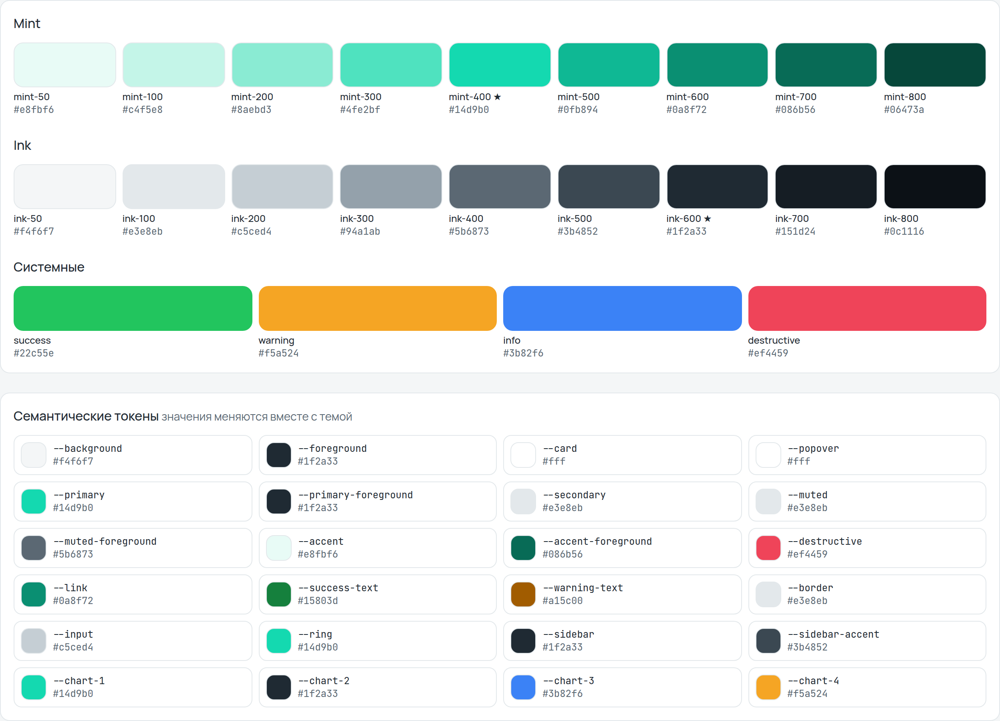 | 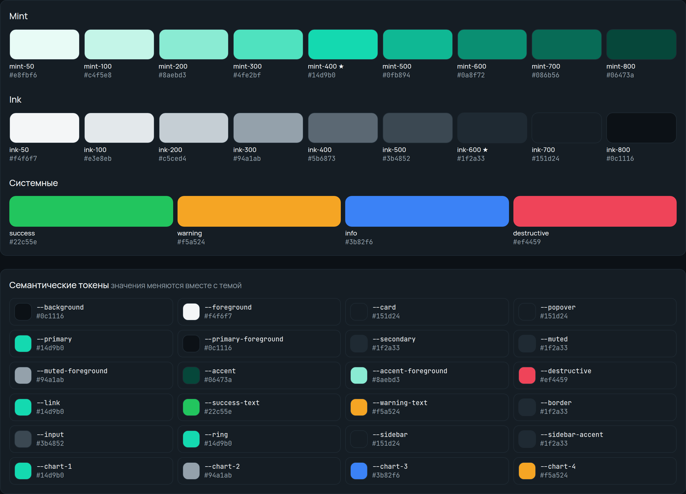 |
| Шрифты, радиусы, тени | 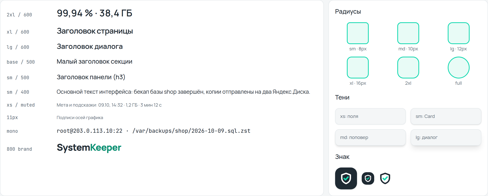 | 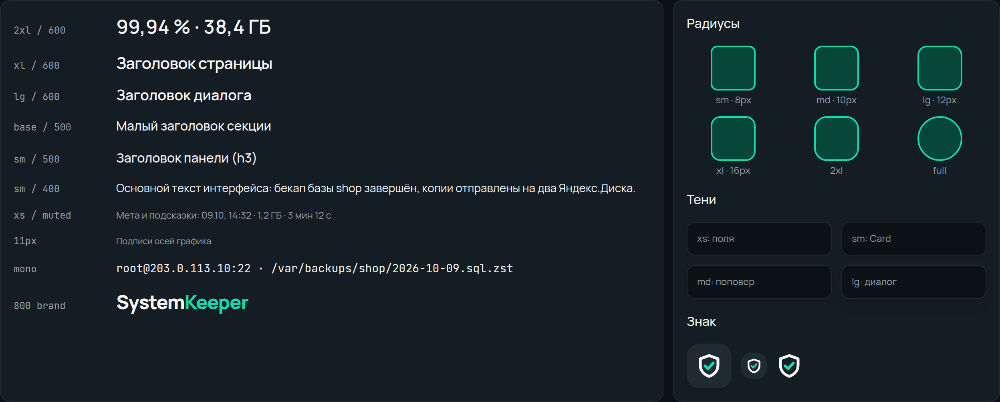 |
| Компоненты | 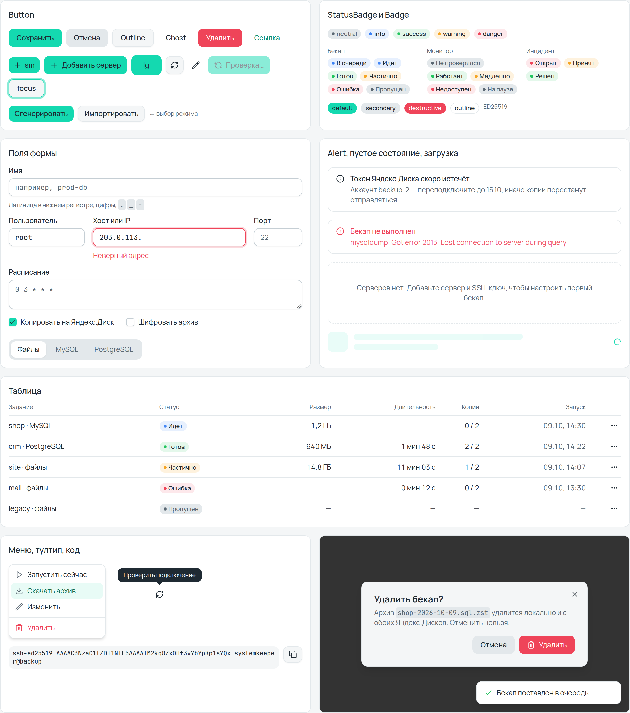 | 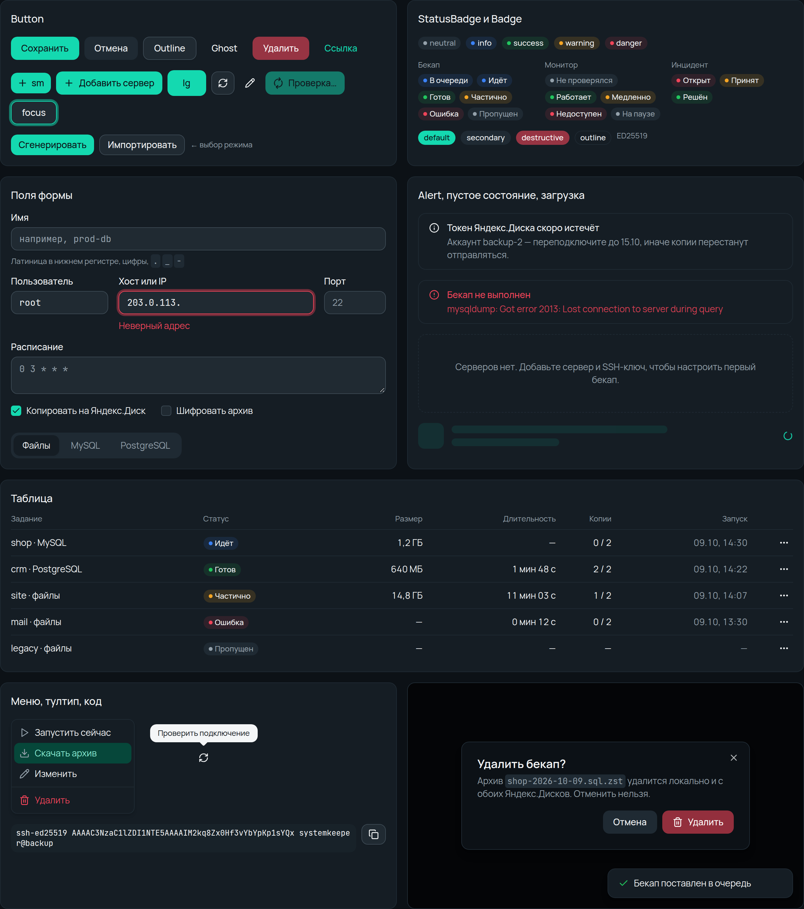 |
| Список серверов | 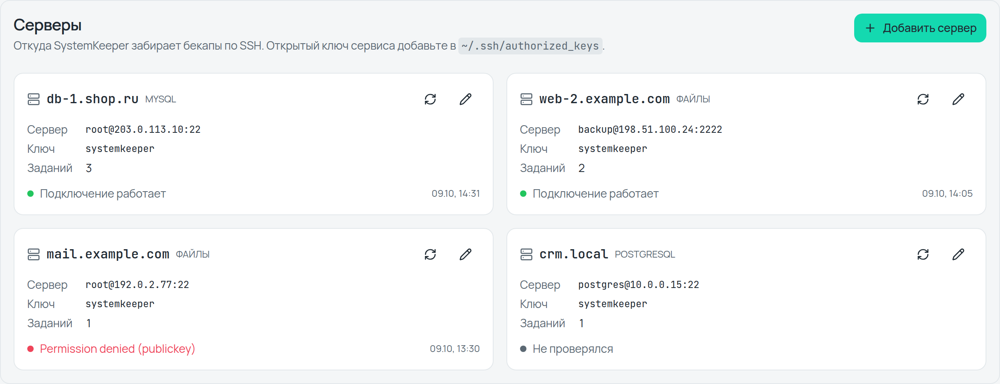 | 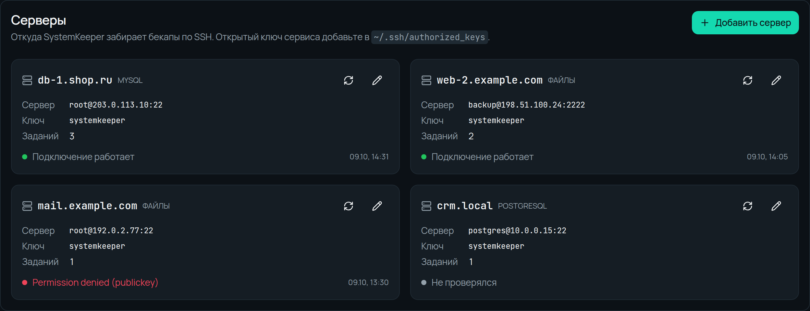 |
| Вход | 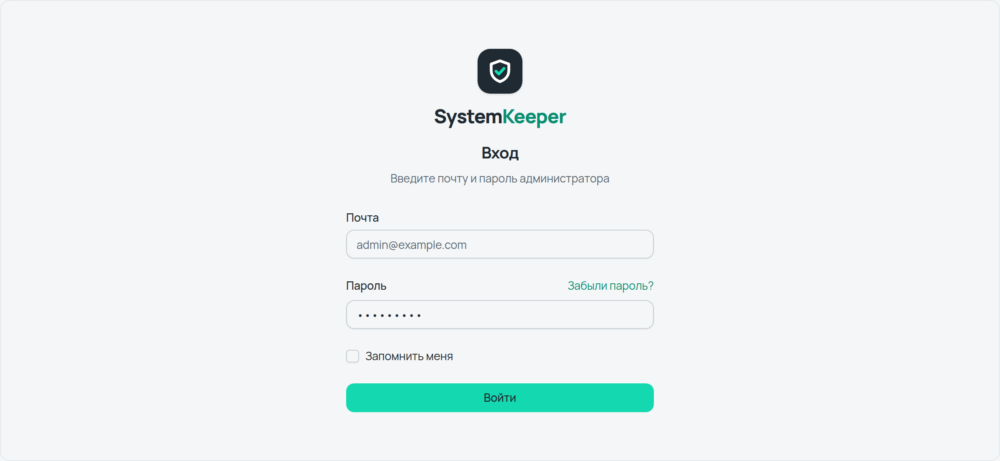 | 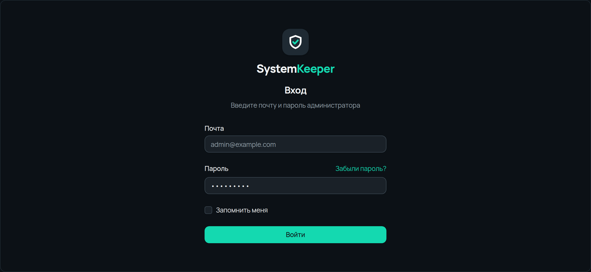 |
| Список на 390px | 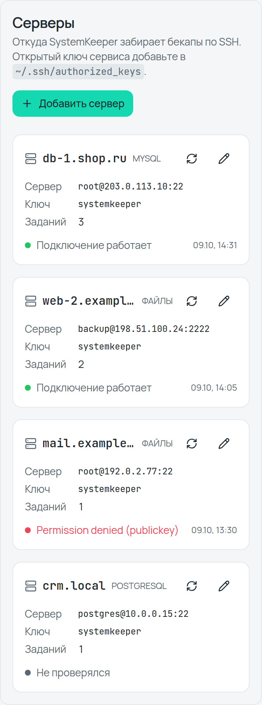 | |

### Как пересобрать витрину

`showcase.css` собран Tailwind v4 из `tokens.css`: без импортов `@fontsource`, с `@source` на `showcase.html` и с `@font-face` на `fonts/`. После правок классов в витрине:

```sh
npx @tailwindcss/cli -i <input.css> -o docs/design-system/showcase.css --minify
```

Открыть витрину: `showcase.html` в браузере. Параметры адреса: `?theme=dark|light`, `?hover=N` — подсветить столбец графика.
